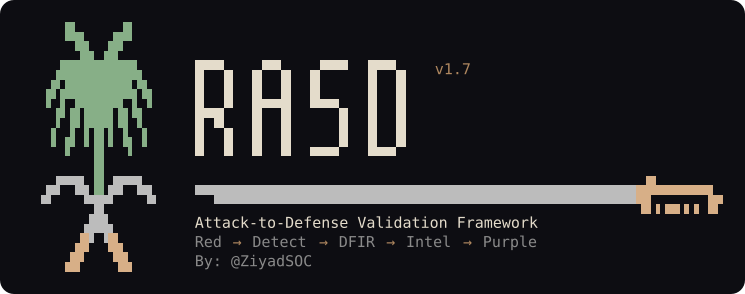
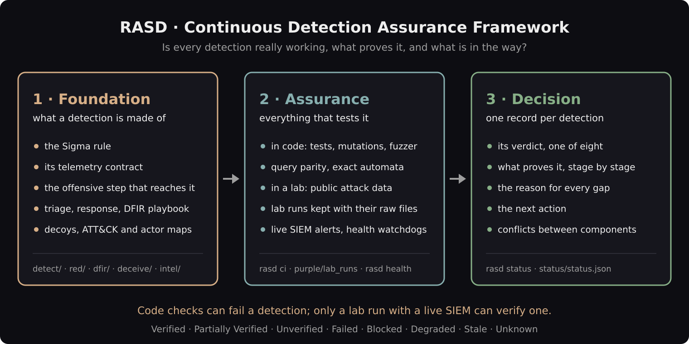

<div align="center">

# RASD: Continuous Detection Assurance Framework



**Is every detection really working, what proves it, and what is in the way?**

[](https://github.com/engziyad/RASD/actions/workflows/detection-ci.yml)


<!-- rasd:status:start -->


**Status:** 15 of 22 detections Verified: each fired on a real attack step in a lab and a live SIEM raised its alert; 7 Blocked, each with the reason and the next step ([status](status/README.md)).
<!-- rasd:status:end -->

</div>

## What RASD is

**RASD (Resilient Adversary Signal Detection)** keeps one record of every detection's state: its rule and the telemetry it needs, what the build proves about it, the attack step that fired it in a lab, the alert a live SIEM raised for it, and whatever is in the way of the rest. Each detection gets one verdict, the reason for it and the next action, and every stage names the file it rests on.

Code checks can fail a detection, never verify one. A thousand passing tests do not make up for a telemetry source that is missing or a SIEM that raised no alert: a detection is **Verified** only when its attack step fired in a lab and a live SIEM raised the alert.

## ❓ The five questions

<!-- rasd:questions:start -->
| | Question | Answer | Proof |
|:-:|---|---|---|
| 1 | **What can we detect?** | 22 detections (18 single-event rules, 4 correlations) across 17 ATT&CK techniques, each with its telemetry contract, triage and response | [open](detect/README.md) |
| 2 | **What proves it?** | 15 Verified: each fired on a real attack step in a lab and Splunk Enterprise 10.4.5 raised its alert; 15 of them are recomputed from the raw run kept in the repository on every build. The code checks (22 of 22 pass) can fail a detection, never verify one | [open](purple/lab_runs/README.md) |
| 3 | **Is it still working?** | In production: unknown until RASD reads its SIEM's numbers (`rasd health --json`, then `rasd status --health`). In the lab: the health watchdogs ran quiet beside the hosts of 15 Verified detections | [open](docs/HEALTH.md) |
| 4 | **Where are the gaps, and why?** | 7 Blocked: 4 need a lab domain, 2 need an opt-in step on a lab VM of your own, 1 needs an offensive step that reaches it; 1 alerted in the lab with no step asking for it (T1003.001_lsass_memory_access); 1 with a documented miss on held-out public data (T1558.003_kerberoasting_rc4_tgs) | [open](status/README.md#gaps-and-why) |
| 5 | **What should be fixed now?** | On a lab domain of your own: join the lab VM to it, set the DC's audit policy (`red/lab/Test-LabReadiness.ps1 -Fix`), add `-Spn <lab SPN> -UserList <file of lab accounts>` to `red/lab/Invoke-RasdLabRun.ps1 -LabConfirmed`, then give the run and the DC's Security export (`red/Export-LabTelemetry.ps1 -LogName Security`) to `rasd evidence --run`. It moves 4 detections on, 3 of them critical | [open](status/README.md#next) |

<sub>Answered by `rasd status` from the record every build writes: [status/status.json](status/status.json)</sub>
<!-- rasd:questions:end -->

## 🧱 Three layers



| | Layer | What it holds | Where |
|:-:|---|---|---|
| 🧱 | **Foundation** | What a detection is made of: the Sigma rule, its telemetry contract, the offensive step that reaches it, its triage, response and DFIR playbook, and the decoys it reads | [detect/](detect/) · [red/](red/) · [dfir/](dfir/) · [deceive/](deceive/) · [intel/](intel/) |
| 🧪 | **Assurance** | Everything that tests it. In code: tests, mutations, the evasion fuzzer, query parity, exact automata. In a lab: public attack data, lab runs kept with their raw files, a live SIEM's alerts, the health watchdogs, the evidence | [proofs](docs/PROOFS.md) · [public data](docs/PUBLIC_DATA_VALIDATION.md) · [lab runs](purple/lab_runs/README.md) · [health](docs/HEALTH.md) |
| 🧭 | **Decision** | One record per detection: its verdict, what proves it, the reason for every gap, the next action, and any contradiction between components | [status](status/README.md) · `rasd status` |

## 🚀 Quick start

Requires Python 3.10+ and PyYAML. On Windows, create the environment with `py -m venv .venv` and activate it with `.venv\Scripts\activate`.

```bash
git clone https://github.com/engziyad/RASD.git && cd RASD
python3 -m venv .venv && . .venv/bin/activate
pip install -e .
rasd status
```

| Command | What it answers |
|---|---|
| `rasd status` | The five questions, from the record every build writes |
| `rasd status --gaps` | Every detection short of Verified, and why |
| `rasd status --next` | What to do next, and the detections each action moves on |
| `rasd status --detection <id>` | One detection, stage by stage, each stage with the file it rests on |
| `rasd ci` | Everything the CI workflow proves, in order |

## 🚪 Four doors

| | Door | Behind it |
|:-:|---|---|
| 🧭 | **[Overview](docs/RASD_OVERVIEW.md)** | What RASD is, the questions it answers and how the three layers fit together |
| 📊 | **[Status](status/README.md)** | Every detection's verdict, its gaps and why, the next actions, and the conflicts checked |
| 🧪 | **[Evidence](purple/lab_runs/README.md)** | The lab runs kept with their raw files, and the [plan](docs/EVIDENCE_PLAN.md) for every detection still waiting |
| 📚 | **[Documentation](docs/README.md)** | Every page, module and command, by layer |

[الدليل بالعربي](docs/GUIDE_AR.md)

## 🛡️ Scope and safety

Offensive tests run only with an explicit lab confirmation, on disposable machines you own or on a hosted runner that exists for one run ([lab workflow](.github/workflows/lab-run.yml)), and a [lab guard](red/lab/README.md#lab-guard) checks the machine itself: a test refuses to run on any host its owner has not marked as a lab, so a script started by mistake on a work machine stops before it does anything. Credential access and Security-log clearing are opt-in and never run on a machine that is not yours, every artifact carries a run marker so cleanup can only touch what the test created, web tests refuse public targets, connect only to the address they checked and never follow a redirect, and the password-spray simulation cannot succeed by design and skips any account one more failure could lock. The lab Sysmon configuration is intentionally verbose for validation: do not deploy `red/lab/sysmon-rasd.xml` to production. Samples and replay data are synthetic; `purple/lab_runs` holds the raw files of lab runs made on machines that existed for the run; `datasets/extracts` holds reduced events from public attack datasets under their own licenses ([notice](datasets/NOTICE.md)); no production logs belong in this repository.

## License

[MIT](LICENSE)

<p align="center"><sub>By: @ZiyadSOC</sub></p>
