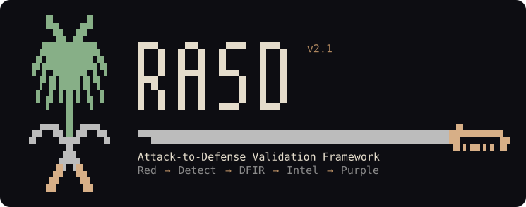
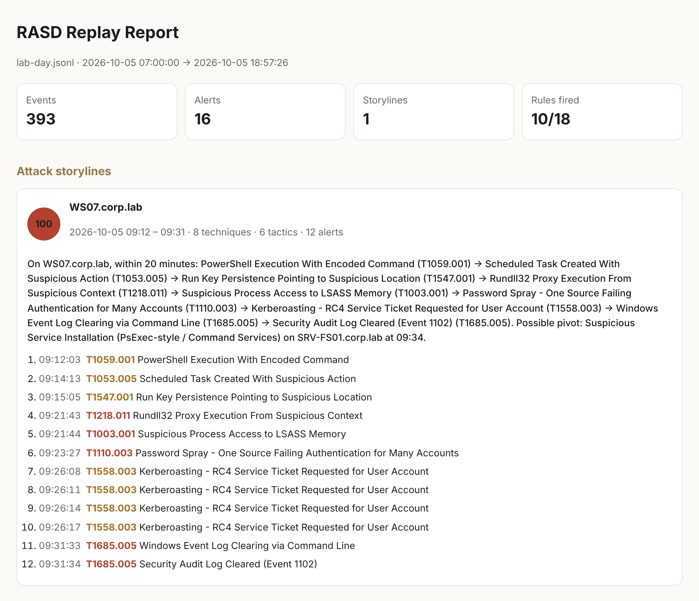

<div align="center">

# RASD: Attack-to-Defense Validation Framework



**RASD // Offensive Validation • Detection Logic • Operational Evidence**

*Attack simulated. Signals captured. Logic tested. Response ready.*

[](https://github.com/engziyad/RASD/actions/workflows/detection-ci.yml)


<!-- rasd:status:start -->


**Status:** SIEM-Ready, not yet Validated: 18 of 18 detections are SIEM-Ready and 16 fire on public attack datasets, meeting 25 of 26 expectations in 23 of 105 held-out files ([public data](docs/PUBLIC_DATA_VALIDATION.md)); none has lab evidence yet ([evidence plan](docs/EVIDENCE_PLAN.md)).
<!-- rasd:status:end -->

</div>

RASD is a cybersecurity validation framework that connects offensive security labs, detection engineering, DFIR playbooks, CTI mapping, and purple-team validation into one measurable workflow.

**RASD = Resilient Adversary Signal Detection**, an attack-to-defense validation framework built to transform adversary behavior into tested detections, investigation workflows, CTI mappings, and operational evidence.

> RASD does not stop at detection logic.
> Each technique is mapped across offensive validation, telemetry, detection, triage, response and intelligence context, with a place for measurable operational evidence that stays pending until a lab run is committed.

<!-- rasd:readme-metrics:start -->
| | |
|---|---|
| **Detections · techniques** | 18 detections (14 single-event, 4 correlations) across 14 ATT&CK v19.2 techniques ([legacy v18 aliases](intel/mappings/attack_v18_aliases.yml)) |
| **Offensive tests** | 19: 14 mapped to current detections (only these can raise the Operational Score) · 5 gap or posture tests reserved for future coverage |
| **Tests** | 313 cases · 494 mutations · 1546 fuzzer variants (0 bypasses) on the 14 single-event rules; the 4 correlation base rules add 51 cases, 24 technique mutations and 53 fuzzer variants |
| **Proof** | 230/230 rule mutants killed or accepted · 13990 parity verdicts per backend (0 divergences) · Defender advanced hunting: 7 rules on 11300 events, each in both FolderPath forms (0 divergences) |
| **Correlations** | 43 scenarios · 24/24 parameter mutants killed · 4502 aggregation parity runs (0 divergences) · burst guarantee verified |
| **Exact automata** | 18/18 Sigma rules compiled to exact automata over every Unicode code point (2603 states) · 36 constructed events, a firing event and its nearest quiet event per rule, each replayed through the engine ([certify](docs/CERTIFY.md)) |
| **Behaviour proofs** | 25 variants of documented attacker behaviour over 5 detections: 12 proven for every event, 12 known gaps (each shown by an engine-confirmed event), 1 exclusion proven quiet ([certificates](docs/CERTIFICATES.md)) |
| **Near misses** | 167 events one field edit away from an alert, on 8 boundaries (8 pinned by a true negative) · correlation headroom T1110.003_password_spray_burst 4, T1558.003_kerberoasting_volume 1 · not measured, no events of their log source in the replay corpus: T1053.003_crontab_noninteractive_install, T1059.004_linux_suspicious_shell_execution, T1190_object_id_enumeration, T1190_object_id_enumeration (base), T1595.003_api_auth_probing, T1595.003_api_auth_probing (base) |
| **Public datasets** | 16/18 detections fire on the pinned public attack data that records their behaviour · 114 in-sample files from 3 sources (219 with the held-out files) · 253 alerts on the recorded attacks, 555 on the labs' own activity (each explained), 1 labelled false positive on these lab captures · held-out: 25 of 26 expectations met, in 23 of 105 files labelled before their first replay ([public data](docs/PUBLIC_DATA_VALIDATION.md)) |
| **Engineering Score** | 100/100 |
| **Operational Score** | pending a real lab run |
| **Chain completeness** | 252/280 items ([validation matrix](purple/validation_matrix.md)) |

<sub>Counted by `tools/chain.py` on every build.</sub>
<!-- rasd:readme-metrics:end -->

## Core Pillars

| Pillar | Purpose |
|---|---|
| [RASD-Red](red/) | Controlled offensive validation |
| [RASD-Detect](detect/) | Detection engineering and SIEM logic |
| [RASD-DFIR](dfir/) | Investigation, evidence, and response |
| [RASD-Intel](intel/) | CTI to detection opportunities |
| [RASD-Purple](purple/) | Attack-to-defense validation |

## Workflow

```text
Red behavior generates telemetry.
Telemetry drives detection logic.
Detection triggers investigation.
Investigation produces evidence.
CTI gives context.
Purple validation measures the full chain.
```

```text
Adversary Behavior → Controlled Offensive Validation → Expected Telemetry → Detection Logic → SPL / KQL → Tests
→ Mutation Testing → Triage → Response / DFIR Playbook → Closure / Escalation → CTI Mapping → Purple Scenario
→ Operational Evidence → Metrics
```

RASD keeps legacy ATT&CK v18 aliases for compatibility, while primary mappings follow ATT&CK v19.2 ([aliases](intel/mappings/attack_v18_aliases.yml)). ATT&CK v20, released on 13 October 2026, changes no ID or tactic of the techniques RASD maps (checked against its release notes).

## What RASD proves that a rule repository cannot

| Claim | How RASD proves it |
|---|---|
| The rule catches the attack | True-positive tests, hand-written technique mutations, and an **evasion fuzzer** that generates renamed binaries, forward-slash paths, parameter prefixes, hex/decimal encodings and ordinal exports - against a regression baseline |
| Every part of the rule is needed | **Rule mutation testing** (`rasd prove`): every value, field and branch of every rule is deleted in turn, and a test must fail each time. It found 45% of the original rule logic unproven by any test; today every mutant is killed or accepted as equivalent |
| The SIEM query is the tested rule | **Query parity** (`rasd parity`): the generated KQL and SPL, and the Defender XDR advanced hunting queries where a Defender table exists, are parsed back and run by RASD's own interpreter of each language (null fields, case rules, regular expressions) on thousands of events. It found that Splunk silently dropped events with a missing field under `NOT`; the converter now reads those fields null-safely. Running the queries in a live SIEM is part of the lab evidence still pending |
| The rule logic holds for every possible value, not only for samples | **Exact automata** (`rasd certify`): every rule is compiled into finite automata that accept exactly what the engine accepts, over every Unicode code point rather than a sample of them. From the automata certify builds an event that fires the rule and the nearest event that does not, and replays both through the engine; a rule that could never fire, or could never stay quiet, would be proven so and fail the build. Each value test is checked against the engine on its complete W-method conformance suite ([the mathematics](docs/CERTIFY.md)) |
| The rule catches the attack however it is written | **Behaviour proofs** (`rasd certify`): a detection's `behavior.yml` writes down, from vendor source code and documentation, the ways its technique can appear in the events the rule reads, including how Windows splits a command line into the arguments the program actually receives. Each variant is proven caught for every possible event, or an event that slips past is shown and replayed through the engine. The first specs prove every documented spelling of `-EncodedCommand` caught and found quote and white-space tricks such as `-e"n"c` that are not; each gap is listed with its fix, and CI fails on a gap the spec does not list ([certificates](docs/CERTIFICATES.md)) |
| Attacks no single event shows are caught | **Sigma correlation detections** (`rasd correlate`): a password spray, Kerberoasting by volume, API authentication probing and object-ID enumeration, as tested rules rather than hunts. Every threshold, window, group-by and normalisation is held in place by an event-sequence scenario (parameter mutation testing); the generated SPL and KQL aggregations are parsed back and must return the engine's exact alerts for the rule and every mutant; and each carries a **proven burst guarantee**: 2T-1 distinct values in one window length always alert, whatever the window alignment (for the spray, 9 accounts in 10 minutes) |
| You know where false positives will come from | **Near-miss analysis** (`rasd nearmiss`): every event one field edit away from an alert, each proven by a witness the engine confirms, grouped by the condition holding it back; CI fails when a boundary carrying traffic has no true negative pinning it. For correlations, the headroom between the busiest quiet window and the threshold |
| It stays quiet on normal activity | True-negative tests, a filter-coverage gate, and **tuning impact analysis** (`rasd tune`) that measures every proposed filter: attack variants hidden versus corpus alerts removed |
| The analyst knows what to do | Triage and response cards, closure notes (benign or false positive) and an escalation note, generated from each detection's contract (L1 / L2 / IR actions, risk model, evidence, containment), and a DFIR playbook for every technique |
| The offensive test and the rule agree | Every red test's sample event **is** one of its detection's true positives, and CI proves it matches |
| It fires on attack telemetry recorded by others | **Public dataset replay** (`rasd datasets`): files from three public sources (Splunk Attack Data, OTRF Security-Datasets, EVTX-ATTACK-SAMPLES), each pinned to a commit and a SHA-256, replayed through every detection and correlation. Every alert is either the recorded attack or explained in the catalog (the labs' test harness, other benign activity, or false positive); every record is counted once, with repeats inside a file and copies between files found and declared; every documented limit is re-checked on each run; and the applied tunings are measured on the labs' background activity. It showed rules blind to real attacks - Invoke-Mimikatz and PPLdump behind the LSASS rule's System32 filter, a bare `cmd.exe` service binary, three rundll32 proxy exports, a Run value pointing into `C:\Windows\Tasks`, sprays over guessed account names - and each fix is proven on the public events, so those rules' results there are marked in-sample. Public data is not lab evidence: it does not raise a detection's maturity |
| It can be proven in a real environment | `rasd evidence` joins a lab run, its telemetry export and optional SIEM alerts, and writes evidence only when the rule really fired on an event bound to that run (host or client address, time window, run marker) - with the SHA-256 of every input. No run is committed yet: the status line above says how many detections have one |
| Nothing is overstated | Maturity levels and both scores are computed; a contract cannot claim more than the repository proves. Without lab evidence a detection stops at **SIEM-Ready** (deployable, not validated), and the Operational Score stays **pending** until a real run is committed |

## Quick start

Requires Python 3.10+ and PyYAML.

```bash
git clone https://github.com/engziyad/RASD.git && cd RASD
python3 -m venv .venv && . .venv/bin/activate     # Windows: py -m venv .venv, then .venv\Scripts\activate
pip install -e .                  # installs the rasd command for this clone
rasd ci                           # the full pipeline CI runs, in order (CI adds code and script checks)
rasd chain                        # the 20-point attack-to-defense map per technique
rasd correlate -v                 # the correlation proofs, scenario by scenario and mutant by mutant
rasd certify -v                   # every rule as exact automata: the shortest event that fires it, the nearest that does not
rasd nearmiss                     # traffic one field edit away from an alert; correlation headroom
rasd datasets fetch && rasd datasets run   # about 730 MB of pinned public attack data (in-sample and held out) through every rule; EVTX files need pip install -e .[datasets]
rasd replay samples/replay/lab-day.jsonl --assets samples/replay/assets.csv --users samples/replay/users.csv --html report.html
```

Without installing, every command also runs as `python rasd.py <command>` after `pip install -r requirements.txt`. Offline, or behind a package mirror without build isolation: `python -m pip install -e . --no-build-isolation` (it uses the setuptools already installed, which must be 77 or newer for the SPDX license field). For changes to the tools themselves, `pip install -r requirements-dev.txt` adds ruff (lint and security rules) and mypy, which CI and the pre-commit hooks run. Security linting is currently covered through Ruff S-rules. Bandit may be added later as an optional CI gate. On Debian, Ubuntu or Kali, `sudo apt install python3-venv` provides `venv`, and `sudo apt install python3-yaml` is enough for `python3 rasd.py ...`.

The last command writes the replay report: every rule and correlation run over a synthetic lab day, alerts ranked by risk, and the intrusion rebuilt as one storyline (command lines hidden in this capture).



Real evidence, on an isolated Windows lab VM that forwards to Splunk ([lab kit](red/lab/README.md)):

```powershell
.\red\lab\Test-LabReadiness.ps1 -Fix                 # Sysmon live probe, audit policy, forwarder, connection

# Safe default: skips credential access (LSASS dump) and the Security-log clear
.\red\lab\Invoke-RasdLabRun.ps1 -LabConfirmed

# Full validation attempt for every Windows detection (disposable VM, snapshot first)
.\red\lab\Invoke-RasdLabRun.ps1 -LabConfirmed -IncludeCredentialAccess -IncludeSecurityLogClear -Spn <lab SPN> -UserList <lab accounts>
```

A run produces one workstation zip; Kerberoasting and the password spray also need the DC's export (`dc-export.jsonl`) and the SIEM part needs the Splunk alert export (`siem-alerts.csv`). `rasd evidence --run` reads the zip as it is: it refuses a zip that differs from the `.sha256` beside it, a file that differs from the run's manifest or is not in it, and an artifact that differs from the hash the runner recorded, then finds the results, the telemetry and the alert export by name and content:

```bash
rasd evidence --run lab-20261012-101500.zip dc-export.jsonl siem-alerts.csv
```

Linux and web runs use `python3 red/run_red.py` on the lab host, then `red/linux/export_sysmon_linux.py` or `red/web/export_access_log.py` turns the logs into the same JSONL ([operational validation](docs/OPERATIONAL_VALIDATION.md)).

Logs from Elastic, Sentinel ASIM, Defender advanced hunting or Splunk CIM run through the same rules with a [telemetry profile](profiles/README.md): `--profile auto`.

## The `rasd` command

| Stage | Command | What it does |
|---|---|---|
| Author | `new` | Scaffold a detection that fails CI until every file is complete |
| Verify | `lint` | Rules, contracts, tuning guides, evidence files, deep static checks (RE2-safe regex, field names, unused selections) |
| | `sigma` | The Sigma subset RASD supports, each construct checked to give the same verdict in the engine and the generated SPL and KQL; everything else, including values Sigma reads differently, refused with an error |
| | `test` · `mutate` | True-positive / true-negative samples; technique and case mutations |
| | `fuzz` | Automatic evasion variants against a regression baseline |
| | `prove` | Rule mutation testing: is every value, field and branch proven by a test? |
| | `parity` | The generated KQL and SPL return exactly what the tested rule returns |
| | `certify` | Every rule as exact automata over every Unicode character: the shortest event that fires it and the nearest one that does not, built from the automata and replayed through the engine; every behaviour spec proven, or its gaps shown with replayed events |
| | `correlate` | Sigma correlations: scenarios, parameter mutants, aggregation parity, burst guarantee; `--logs` finds correlation alerts in an export |
| | `nearmiss` | Events one field edit away from an alert, the condition holding them back and the true negative pinning it; correlation threshold headroom |
| | `tune` | Security cost and noise benefit of every tuning |
| | `diff` · `overlap` | Events that change verdict against a git ref; detections that co-fire |
| Understand | `explain` | Why a rule matched (or did not) an event, field by field |
| | `score` | Engineering Score and Operational Score |
| Deploy | `build` · `convert` | KQL + SPL for rules and correlations, Defender XDR advanced hunting for process and registry rules, cards, views, coverage, scores, banner, chain outputs |
| | `doctor` | Is a log export ready for the rules: READY / DEGRADED / BLIND per rule; `--profile` reads ECS, CIM, ASIM or Defender exports |
| | `profiles` | Which telemetry profile fits an export, and which log sources each profile carries |
| | `splunk` | The detections as a Splunk app: one scheduled alert per rule and per correlation (once per window), indexes, forwarder inputs, the alert export for evidence |
| Operate | `red` | Validate and render every offensive test from its test.yml |
| | `replay` | Run every rule and correlation over logs: risk-ranked alerts, noise forecast, attack storylines; `--case-dir` writes a case folder per storyline (summary, `timeline.json`, observables, closure notes to fill in) |
| | `benchmark` | Events per second through rules and correlations, peak memory, slowest rule and regex - on an export or on N synthetic events; `--stream` keeps memory flat at any size |
| | `evidence` | Turn a real lab run into verifiable evidence (FIRED / MISSED), for rules and correlations; `--run` reads the lab run's zip or folder directly, `--strict` also requires the `.sha256` and a complete manifest |
| | `datasets` | Public attack datasets: `fetch` them pinned and hashed, `run` every rule and correlation over them and compare with the catalog (the recorded attack, explained alerts, documented limits), `--write` keeps the result; `check` replays the committed extracts in CI |
| | `chain` · `links` | The completeness map, maturity, matrices and metrics; every Markdown link resolves |
| All | `ci` | The full pipeline, in order (the CI workflow adds ruff, mypy, script parse checks and the drift check) |

## Coverage

What the repository detects today, and what it only exercises. Detections are counted from `detect/detections` and `detect/correlations`; red tests without a detection are measured gaps, not coverage.

| Area | Status | What exists |
|---|---|---|
| Windows process activity (Sysmon 1) | Covered | PowerShell encoded commands, scheduled tasks (schtasks and cmdlets), rundll32 proxy execution, wevtutil log clearing, shells and proxy binaries started by a WinRM session host |
| Windows process access (Sysmon 10) | Covered | LSASS memory access |
| Windows registry (Sysmon 13) | Covered | Run / RunOnce persistence |
| Windows Security log | Covered | Security log cleared (1102), RC4 Kerberos service tickets (4769); authentication failures for many accounts (4771, 4768, 4625) and service tickets of any encryption (4769) counted by the correlations |
| Windows System log | Covered | Other logs cleared (104), suspicious service installation (7045) |
| Active Directory | Partial | Kerberoasting (RC4 rule + encryption-agnostic volume correlation); password spray (correlation, tested on its red test's scenario; lab run pending); LDAP enumeration as a red test only |
| Web applications (access log) | Partial | API authentication probing and object-ID enumeration (correlations); JWT, file upload and security headers as red tests only |
| Linux (Sysmon for Linux 1) | Partial | Crontab installed from standard input or a file, Base64 decoded into a shell, execution from /tmp, /var/tmp and /dev/shm; privilege-escalation recon as a red test only |
| Cloud (Entra ID, AWS, Azure) | Not covered | Planned in the [roadmap](docs/RELEASE_ROADMAP.md#after-v20-new-data-domains), after lab data exists |
| Email | Not covered | Planned, after lab data exists |
| WAF / NDR | Not covered | Planned, after lab data exists |

## Repository layout

```text
RASD
├── red/        → Offensive Validation      19 tests: Windows, Active Directory, web, Linux
├── detect/     → Detection Engineering     detections, correlations, coverage, quality, evasion baseline
├── dfir/       → Investigation & Response  playbooks, queries, templates, models
├── intel/      → CTI to Detection          templates, technique and actor maps, analyses
├── purple/     → Attack-to-Defense         scenarios, validation / evidence / latency matrices
├── profiles/   → Telemetry profiles: ECS, CIM, ASIM, Defender → rule field names
├── datasets/   → Public attack datasets: catalog, results, reduced extracts, licenses
├── samples/    → Replay corpus, telemetry profile and doctor samples
├── docs/       → Architecture, metrics, maturity, governance
├── tools/      → Automation, scoring, validation, generation
├── schemas/    → Contract, mutation and tuning schemas
├── queries/    → SPL / KQL / Defender advanced hunting / Hunts / Splunk app
├── tests/      → Unit and framework tests
└── .github/    → CI, issue templates, PR template
```

## Documentation

| | |
|---|---|
| [EXECUTIVE_SUMMARY](docs/EXECUTIVE_SUMMARY.md) · [executive matrix](purple/executive_matrix.md) | One page for decision makers: what is detected, how far it is proven, what is open |
| [RASD_OVERVIEW](docs/RASD_OVERVIEW.md) · [RASD_ARCHITECTURE](docs/RASD_ARCHITECTURE.md) | What RASD is and how it is built |
| [ATTACK_TO_DEFENSE_CHAIN](docs/ATTACK_TO_DEFENSE_CHAIN.md) | Every link of the chain and the check that enforces it |
| [RASD_MATURITY_MODEL](docs/RASD_MATURITY_MODEL.md) · [QUALITY_MODEL](docs/QUALITY_MODEL.md) | Maturity levels; Engineering and Operational Scores |
| [DETECTION_ACCEPTANCE_CRITERIA](docs/DETECTION_ACCEPTANCE_CRITERIA.md) · [WRITING_DETECTIONS](docs/WRITING_DETECTIONS.md) | When a detection is complete; how to write one |
| [SIGMA_SUPPORT](docs/SIGMA_SUPPORT.md) | The Sigma constructs RASD evaluates and converts, and the ones it refuses |
| [CERTIFY](docs/CERTIFY.md) · [CERTIFICATES](docs/CERTIFICATES.md) | Rules as exact automata over every Unicode character: the model, the mathematics, why each answer is a proof; behaviour specs and their certificates |
| [CORRELATIONS](docs/CORRELATIONS.md) | Correlation detections: format, semantics, scenarios, proofs, burst guarantee, SIEM scheduling |
| [PUBLIC_DATA_VALIDATION](docs/PUBLIC_DATA_VALIDATION.md) · [datasets](datasets/README.md) | Every detection replayed on pinned public attack data: what fired, what stays quiet and why, what public data asks for next |
| [OPERATIONAL_VALIDATION](docs/OPERATIONAL_VALIDATION.md) · [EVIDENCE_PLAN](docs/EVIDENCE_PLAN.md) | Lab runs and evidence; which lab machine and step proves each detection |
| [ENTERPRISE_ADOPTION](docs/ENTERPRISE_ADOPTION.md) · [SIEM_DEPLOYMENT_NOTES](docs/SIEM_DEPLOYMENT_NOTES.md) | Taking the detections into an organisation's SIEM; Sentinel and Splunk specifics |
| [RASD_METRICS](docs/RASD_METRICS.md) · [DATA_SOURCE_COVERAGE](docs/DATA_SOURCE_COVERAGE.md) | Counted metrics; telemetry dependencies |
| [Detection backlog](intel/outputs/detection_backlog.md) · [actor tradecraft map](intel/mappings/actor_tradecraft_map.md) | The open gaps ranked by telemetry already mapped and by the groups documented using each technique |
| [CONTROL_EVIDENCE](docs/CONTROL_EVIDENCE.md) · [role views](docs/views/) | Evidence for audit; SOC, IR, GRC and purple-team views |
| [RELEASE_ROADMAP](docs/RELEASE_ROADMAP.md) | v1.0 (this release), v2.0: Reference on lab evidence, and the new data domains after it |
| [GUIDE_AR](docs/GUIDE_AR.md) | الدليل الكامل بالعربي |

## Scope and safety

Offensive tests run only with an explicit lab confirmation, on disposable machines you own, and a [lab guard](red/lab/README.md#lab-guard) checks the machine itself: a test refuses to run on any host its owner has not marked as a lab, so a script started by mistake on a work machine stops before it does anything. Credential access and Security-log clearing are opt-in, every artifact carries a run marker so cleanup can only touch what the test created, web tests refuse public targets, connect only to the address they checked and never follow a redirect, and the password-spray simulation cannot succeed by design and skips any account one more failure could lock. The lab Sysmon configuration is intentionally verbose for validation: do not deploy `red/lab/sysmon-rasd.xml` to production. Samples and replay data are synthetic; `datasets/extracts` holds reduced events from public attack datasets under their own licenses ([notice](datasets/NOTICE.md)); no production logs belong in this repository.

## License

[MIT](LICENSE)

<p align="center"><sub>By: @ZiyadSOC</sub></p>
