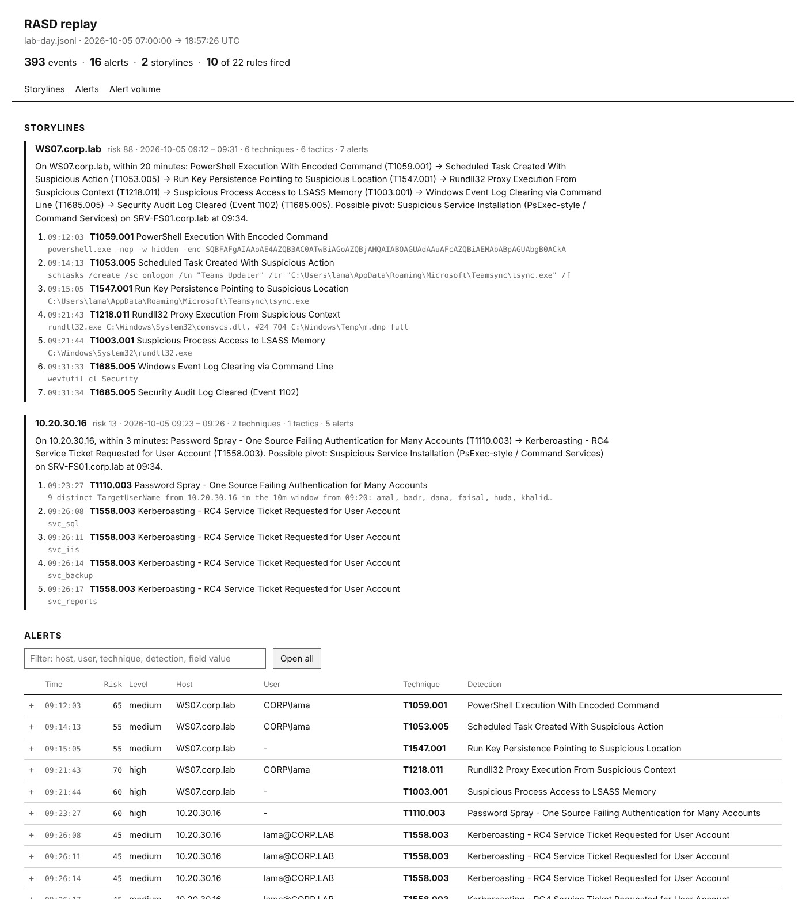

# The `rasd` Command

One command, one sub-command per question, grouped by the layer it belongs to: the **Decision** layer says where every detection stands and what to do next, the **Assurance** layer tests it in code, in a lab and in your own logs, and the **Foundation** is what a detection is made of. `rasd <command> --help` prints what each takes; `rasd ci` runs everything the CI workflow proves, in order.

| Layer | Command | What it does |
|---|---|---|
| **Decision** | `status` | Where every detection stands: one verdict of eight (Verified, Partially Verified, Unverified, Failed, Blocked, Degraded, Stale, Unknown), what proves it stage by stage with the file each stage rests on, the reason for every gap, the next action, and every contradiction between components. `--gaps`, `--critical`, `--next` and `--detection ID` narrow it; `--health FILE` reads production health from the JSON of `rasd health --json`; `--as-of today` judges the evidence's freshness at today's date; `--json` prints the record. The page ([status](../status/README.md)), the front page and this command read the same record, `status/status.json`, and `--check` fails CI when it is out of date or when two components contradict each other |
|  | `advise` | RASD-Agent: what to do next, ranked and evidenced, per role (`--for`); `--logs` your own telemetry; `--explain` an alert; `--propose` and `--apply` verified changes; `--decide` what you decided; `--ask` a question; a model is optional and gated |
| **Assurance, in code** | `test` · `mutate` | True-positive / true-negative samples; technique and case mutations |
|  | `fuzz` | Automatic evasion variants against a regression baseline |
|  | `prove` | Rule mutation testing: is every value, field and branch proven by a test? |
|  | `parity` | The generated KQL and SPL return exactly what the tested rule returns |
|  | `certify` | Every rule as exact automata over every Unicode character: the shortest event that fires it and the nearest one that does not, built from the automata and replayed through the engine; every behaviour spec proven, or its gaps shown with replayed events. `--equiv REF` proves an edit kept each rule's meaning or shows the event that changed |
|  | `correlate` | Sigma correlations: scenarios, parameter mutants, aggregation parity, burst guarantee; `--logs` finds correlation alerts in an export |
|  | `nearmiss` | Events one field edit away from an alert, the condition holding them back and the true negative pinning it; correlation threshold headroom |
|  | `sigma` | The Sigma subset RASD supports, each construct checked to give the same verdict in the engine and the generated SPL and KQL; everything else, including values Sigma reads differently, refused with an error |
|  | `tune` | Security cost and noise benefit of every tuning |
|  | `diff` · `overlap` | Events that change verdict against a git ref; detections that co-fire |
|  | `explain` | Why a rule matched (or did not) an event, field by field |
|  | `score` | Engineering Score and Operational Score |
| **Assurance, in a lab** | `datasets` | Public attack datasets: `fetch` them pinned and hashed, `run` every rule and correlation over them and compare with the catalog (the recorded attack, explained alerts, documented limits), `--write` keeps the result; `check` replays the committed extracts in CI |
|  | `evidence` | Turn a real lab run into verifiable evidence (FIRED / MISSED), for rules and correlations; `--run` reads the lab run's zip or folder directly, `--strict` also requires the `.sha256` and a complete manifest, `--keep` stores a run that may be public in the repository, `--check` recomputes its evidence on every build, `--refresh` rewrites it after a rule's title or fields changed, and `--prune` drops a kept run a later one replaced |
|  | `health` | Is every detection still being fed: an export against a baseline, a verdict per detection (healthy, degraded, blind, unknown) with what broke and what to fix; `--save-baseline` keeps a baseline as counts; `--scheduler` reads the SIEM's record of scheduled runs; `--write` generates the SPL and KQL watchdogs |
|  | `chain` · `links` | The completeness map, maturity, matrices and metrics; every Markdown link resolves |
| **Assurance, in your logs** | `doctor` | Is a log export ready for the rules: READY / DEGRADED / BLIND per rule; `--profile` reads ECS, CIM, ASIM or Defender exports |
|  | `replay` | Run every rule and correlation over logs: risk-ranked alerts, noise forecast, attack storylines; `--case-dir` writes a case folder per storyline (summary, `timeline.json`, observables, closure notes to fill in, the evidence request) |
|  | `trace` | Evidence survivability: per detection and question (ran, when, who, how, origin), whether a sequence of anti-forensic actions can remove the answer, how many actions it needs and whether a rule sees it; the rules that would close the exposure, in order; `<detection> --lost STORES` lists what can still be proven once those stores are gone |
|  | `silence` | Evidence of absence: per detection and host of an export, fired, attested or unattested, with the share of the watched time, the grade (record sequence or rhythm) and every break in the record; `--certificate` writes the certificate and `--html` the same as one page with the map of every sensor over the window; with no export, on Windows, this host's own event logs |
|  | `blindpath` | The unseen route: from each origin to each target of an export, every leg open or held, each unseen behaviour proven by a witness the engine replays or by a sensor the export does not hold; the routes unseen end to end, the first leg that sees each other route, and the fewest changes after which every route is seen by each leg; what each change buys alone; `--certificate`, `--html` (the map of every host and stage), `--json`, `--strict`, `--baseline` (what changed since an earlier answer, exit 1 when it got worse), `--witnesses` (the witness events as JSONL, to replay through your own SIEM); with no export, on Windows, this host's own event logs |
|  | `benchmark` | Events per second through rules and correlations, peak memory, slowest rule and regex - on an export or on N synthetic events; `--stream` keeps memory flat at any size |
| **Foundation** | `new` | Scaffold a detection that fails CI until every file is complete |
|  | `lint` | Rules, contracts, tuning guides, evidence files, deep static checks (RE2-safe regex, field names, unused selections) |
|  | `red` | Validate and render every offensive test from its test.yml |
|  | `deceive` | The decoy inventory against the rules, tests, red tests and the decoy host's configuration; `--rename` adopts your own decoy identities with the proofs intact; `--gaps` ranks the decoy classes not built |
|  | `build` · `convert` | KQL + SPL for rules and correlations, Defender XDR advanced hunting for process and registry rules, cards, views, coverage, scores, banner, chain outputs |
|  | `profiles` | Which telemetry profile fits an export, and which log sources each profile carries |
|  | `splunk` | The detections as a Splunk app: one scheduled alert per rule and per correlation (once per window), indexes, forwarder inputs, the alert export for evidence |
|  | `grow` | RASD-Agent's lane: where every ATT&CK technique stands (core, candidate, queued, declined, out of reach); `--run` drafts the next ones with the configured model and keeps what every gate accepts, with the proof computed; `--sync` reads a new ATT&CK release; `--check` proves every candidate again; `--guard` holds an unattended run to the lane's own files |
|  | `review` | The person's side of the lane: the board, a candidate's dossier with what it will never alert on, a verdict bound to the rule text (`--approve`, `--revise`, `--reject`), `--promote` for an approved text, `--withdraw` and `--rollback`, `--audit` for the chained trail |
| **All** | `ci` | The full pipeline, in order (the CI workflow adds ruff, mypy, script parse checks and the drift check) |

## A longer first session

Requires Python 3.10+ and PyYAML.

```bash
git clone https://github.com/engziyad/RASD.git && cd RASD
python3 -m venv .venv && . .venv/bin/activate
pip install -e .
rasd status
rasd status --next
rasd ci
rasd chain
rasd correlate -v
rasd certify -v
rasd certify --equiv HEAD~1
rasd nearmiss
rasd trace
rasd silence samples/silence/fleet.jsonl --assets samples/silence/assets.csv
rasd blindpath samples/silence/fleet.jsonl --assets samples/silence/assets.csv
rasd advise
rasd grow
rasd datasets fetch && rasd datasets run
rasd replay samples/replay/lab-day.jsonl --assets samples/replay/assets.csv --users samples/replay/users.csv --html report.html
```

On Windows, create the environment with `py -m venv .venv` and activate it with `.venv\Scripts\activate`. In order, the commands above:

| Command | What it shows |
|---|---|
| `pip install -e .` | installs the `rasd` command for this clone |
| `rasd status` · `--next` | where every detection stands and what to do next, from the record every build writes |
| `rasd ci` | the full pipeline CI runs, in order (CI adds code and script checks) |
| `rasd chain` | the 20-point attack-to-defense map per technique |
| `rasd correlate -v` | the correlation proofs, scenario by scenario and mutant by mutant |
| `rasd certify -v` | every rule as exact automata: the shortest event that fires it, the nearest that does not |
| `rasd certify --equiv HEAD~1` | proves an edit preserved what each rule catches, or shows the event that changed |
| `rasd nearmiss` | traffic one field edit away from an alert; correlation headroom |
| `rasd trace` | can the evidence be erased, at what cost, and does a rule see the attempt |
| `rasd silence <fleet> --assets <assets>` | is each rule's quiet evidence: fired, attested or unattested, and every break in the record; with no export, on Windows, the same for this host from its own event logs (read only) |
| `rasd blindpath <fleet> --assets <assets>` | can an intruder cross from an origin to a target with no alert: every unseen step with its proof, and the fewest changes that end it; with no export, on Windows, the same walk on this host alone |
| `rasd advise` | the counsel: what to do next and why, per role; `--logs` reads your own export, `--explain` an alert |
| `rasd grow` | RASD-Agent's lane: where every ATT&CK technique stands and what is drafted next; `--run` drafts with the configured model and keeps what every gate accepts |
| `rasd datasets fetch && rasd datasets run` | about 730 MB of pinned public attack data (in-sample and held out) through every rule; EVTX files need `pip install -e .[datasets]` |
| `rasd replay ... --html report.html` | the replay report described below |

Without installing, every command also runs as `python rasd.py <command>` after `pip install -r requirements.txt`. Offline, or behind a package mirror without build isolation: `python -m pip install -e . --no-build-isolation` (it uses the setuptools already installed, which must be 77 or newer for the SPDX license field). For changes to the tools themselves, `pip install -r requirements-dev.txt` adds ruff (lint and security rules) and mypy, which CI and the pre-commit hooks run. Security linting is currently covered through Ruff S-rules. Bandit may be added later as an optional CI gate. On Debian, Ubuntu or Kali, `sudo apt install python3-venv` provides `venv`, and `sudo apt install python3-yaml` is enough for `python3 rasd.py ...`.

The last command writes the replay report: every rule and correlation run over a synthetic lab day, alerts ranked by risk, and the intrusion rebuilt as one storyline (command lines hidden in this capture).



Real evidence, on an isolated Windows lab VM that forwards to Splunk ([lab kit](../red/lab/README.md)):

First the readiness check (Sysmon live probe, audit policy, forwarder, connection), then the safe default run, which skips credential access (the LSASS dump) and the Security-log clear. The third command is the full validation attempt for every Windows detection, on a disposable VM, from a snapshot.

```powershell
.\red\lab\Test-LabReadiness.ps1 -Fix
.\red\lab\Invoke-RasdLabRun.ps1 -LabConfirmed
.\red\lab\Invoke-RasdLabRun.ps1 -LabConfirmed -IncludeCredentialAccess -IncludeSecurityLogClear -Spn <lab SPN> -UserList <lab accounts>
```

A run produces one workstation zip; Kerberoasting and the password spray also need the DC's export (`dc-export.jsonl`) and the SIEM part needs the Splunk alert export (`siem-alerts.csv`), with `siem.json` beside it when `red/lab/splunk_lab.py` recorded which Splunk raised the alerts. `rasd evidence --run` reads the zip as it is: it refuses a zip that differs from the `.sha256` beside it, a file that differs from the run's manifest or is not in it, and an artifact that differs from the hash the runner recorded, then finds the results, the telemetry and the alert export by name and content:

```bash
rasd evidence --run lab-20261012-101500.zip dc-export.jsonl siem-alerts.csv
```

Linux and web runs use `python3 red/run_red.py` on the lab host, then `red/linux/export_sysmon_linux.py` or `red/web/export_access_log.py` turns the logs into the same JSONL ([operational validation](OPERATIONAL_VALIDATION.md)).

Logs from Elastic, Sentinel ASIM, Defender advanced hunting or Splunk CIM run through the same rules with a [telemetry profile](../profiles/README.md): `--profile auto`.

<sub>RASD · Continuous Detection Assurance Framework</sub>
