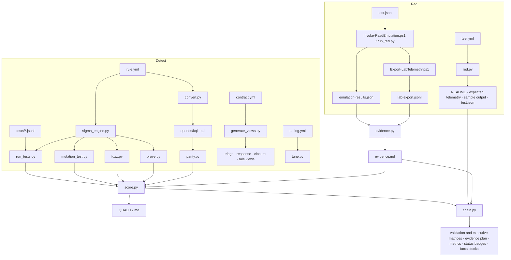

# RASD Architecture

## Design goals

1. **Single source of truth.** A detection is written once, in Sigma; every SIEM query, card and matrix is generated from it.
2. **Provable.** Every claim - "fires on the attack", "quiet on normal activity", "the query is the rule", "the test is needed", "it was validated" - is checked by a script.
3. **Offline and portable.** The pipeline runs with Python and PyYAML. No SIEM licence, cloud account or network access is needed to test a rule.
4. **Honest.** Coverage, maturity and scores are computed, never typed. What cannot be proven inside the repository is shown as *pending*, never estimated.

## Repository layout

```text
RASD
├── red/        Offensive validation: one test.yml per test, runners, telemetry exporter
├── detect/     Detections, correlations, ATT&CK coverage, Engineering and Operational Scores, evasion baseline, risk conditions
├── dfir/       Playbooks, investigation queries, templates, models
├── intel/      CTI templates, technique and actor maps, worked analysis, outputs
├── purple/     Scenarios and the generated validation, evidence and latency matrices
├── profiles/   Telemetry profiles: ECS, CIM, ASIM, Defender field names to rule field names
├── datasets/   Public attack datasets: catalog, results, reduced extracts, licenses
├── docs/       Architecture, metrics, maturity, governance
├── tools/      The engine and every tool behind the rasd command
├── schemas/    JSON schemas for contracts, mutations and tuning guides
├── queries/    Generated KQL / SPL, hand-written hunts
├── samples/    Replay corpus and doctor samples
├── tests/      Unit and framework tests
└── .github/    CI, issue templates, pull request template
```

## Components



### Engine and conversion
- **`sigma_engine.py`** - a recursive-descent implementation of Sigma matching (selections, value lists, `contains/startswith/endswith/re/all/cased/exists`, wildcards, `null`, `and/or/not`, `1 of / all of`). Unsupported syntax raises an error instead of silently returning false. `explain()` returns a field-by-field trace of why an event matched.
- **`convert.py`** - Sigma to KQL and SPL with the engine's own grammar. Inside a negation, SPL fields are read as `coalesce('F', "")`, because in Splunk `NOT` over a missing field is NULL and the event would be dropped silently - a bug `parity.py` found and proves fixed.

### Proof tools
| Tool | Question it answers |
|---|---|
| `validate.py` | Is every rule, contract, tuning guide and evidence file complete and consistent? Deep lint: unused selections, field-name case, invalid regex, RE2-incompatible regex (lookarounds, backreferences, possessive quantifiers), duplicate values, very short substrings |
| `run_tests.py` | Does the rule match every true positive and no true negative? |
| `mutation_test.py` | Does it survive hand-written technique variants and case changes? |
| `fuzz.py` | Does it survive automatic evasion variants (renamed binaries, forward slashes, parameter prefixes, hex/decimal, ordinals)? |
| `prove.py` | Would the tests notice if any value, field or branch of the rule were deleted? |
| `parity.py` | Do the generated KQL and SPL, and the Defender advanced hunting queries, return exactly what the rule returns? |
| `correlate.py` | Is every correlation proven: base rule, event-sequence scenarios, parameter mutants, aggregation parity of the generated SPL and KQL, burst guarantee? (engine and conversion in `correlation.py`) |
| `nearmiss.py` | Which events are one field edit away from an alert (proven by a witness), which condition holds them back, is it pinned by a true negative, and how close quiet windows come to each correlation threshold? |
| `diff.py` | Which events change verdict between this rule and the one in a git ref? |
| `overlap.py` | Which detections fire on the same events? |
| `tune.py` | What does a proposed filter hide, and what noise does it remove? |
| `doctor.py` | Is a log export ready for the rules (fields present, aliases, truncation)? |

### Operations tools
| Tool | Purpose |
|---|---|
| `replay.py` | Runs every rule and correlation over logs: alerts, risk score from the contract risk model, noise forecast, kill-chain storylines, HTML report, and a case folder per storyline (`--case-dir`) |
| `benchmark.py` | Events per second through the compiled rules and the correlations, peak memory, slowest rule and regex |
| `evidence.py` | Joins a lab run's results with its telemetry export (and SIEM alerts) and writes verifiable evidence; `--run` reads the run's zip or folder and checks it against its hashes first |
| `red.py` | Validates and renders every offensive test from its test.yml |
| `sigma_support.py` | Which Sigma constructs are supported (same verdict in the engine, SPL and KQL on a probe matrix) and which are refused; writes SIGMA_SUPPORT.md |
| `chain.py` | Builds the 20-point map, maturity levels, matrices (validation, executive, evidence, latency), the evidence plan, the detection backlog, metrics, README status badges and gates |
| `score.py` | Engineering Score and Operational Score |
| `coverage.py`, `generate_views.py` | ATT&CK Navigator layer and coverage matrix; triage, response, closure and escalation notes, role views |
| `links.py` | Every relative Markdown link resolves |

## CI pipeline

`.github/workflows/detection-ci.yml` runs `rasd ci` and then the drift check:

1. lint (rules, contracts, tuning guides, evidence)
2. unit tests (engine, converter, every tool)
3. detection tests, mutation tests
4. fuzz `--check` (no new bypass), prove (no surviving rule mutant), parity (no divergence), correlate `--check` (every correlation proven, queries current), nearmiss `--check` (every boundary carrying replay traffic pinned by a true negative)
5. tune `--check`, red `--check`, PowerShell parse check of every red script
6. build: queries (rules and correlations), views, coverage, scores, banner, chain (matrices, metrics, intel maps, facts blocks)
7. chain `--check` and link check
8. **drift check**: any generated file that differs from what the sources produce fails the build
