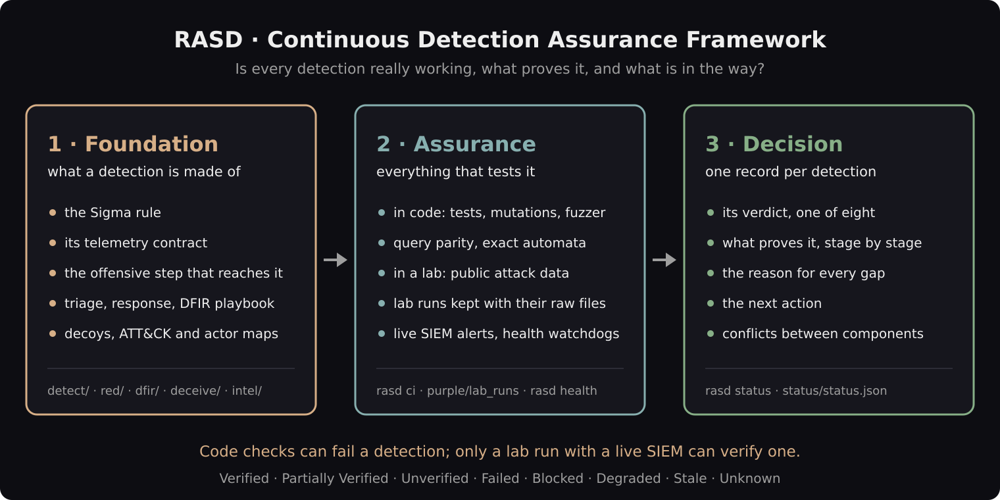
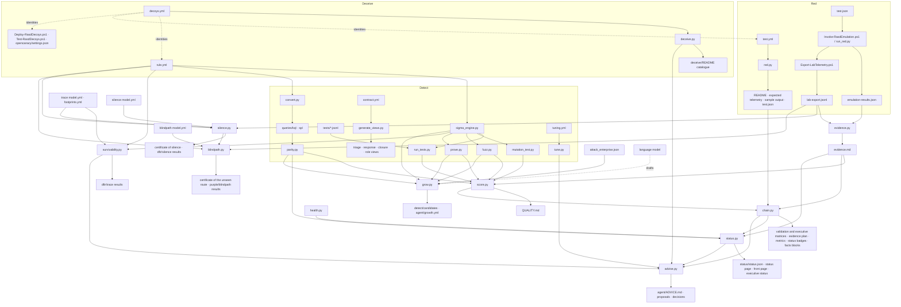

# RASD Architecture

## Design goals

1. **Single source of truth.** A detection is written once, in Sigma, and its state is kept once, in the status record; every SIEM query, card, matrix and status line is generated from them.
2. **Provable.** Every claim - "fires on the attack", "quiet on normal activity", "the query is the rule", "the test is needed", "it was validated" - is checked by a script.
3. **Offline and portable.** The pipeline runs with Python and PyYAML. No SIEM licence, cloud account or network access is needed to test a rule.
4. **Honest.** Coverage, maturity and scores are computed, never typed. What cannot be proven inside the repository is shown as *pending*, never estimated.

## Three layers



| Layer | What it holds | Tools |
|---|---|---|
| **Foundation** | What a detection is made of: the Sigma rule, its telemetry contract, the offensive step that reaches it, its triage, response and DFIR playbook, the decoys it reads, the intelligence that ranks what comes next, and the candidates RASD-Agent grows apart from the core | `validate.py` · `red.py` · `deceive.py` · `convert.py` · `splunk_app.py` · `profiles.py` · `generate_views.py` · `coverage.py` · `grow.py` · `review.py` |
| **Assurance** | Everything that tests it. In code: tests, mutations, the evasion fuzzer, rule mutants, query parity, exact automata, correlation proofs. In a lab: public attack data, lab runs kept with their raw files, a live SIEM's alerts, evidence recomputed on every build. In your own logs: health, evidence survivability, evidence of absence, the unseen route | `run_tests.py` · `mutation_test.py` · `fuzz.py` · `prove.py` · `parity.py` · `certify.py` · `correlate.py` · `datasets.py` · `evidence.py` · `health.py` · `survivability.py` · `silence.py` · `blindpath.py` · `score.py` · `chain.py` |
| **Decision** | One record per detection (`status/status.json`): its checks stage by stage, each naming the file it rests on, one verdict of eight, the reason for every gap, the next action, and every contradiction found between components. The status page, the front page, the executive summary and RASD-Agent's lab-run findings read it | `status.py` · `advise.py` |

Modules report what they measure; only the Decision layer gives a detection its verdict. Code checks can fail a detection, never verify one: **Verified** takes a lab step that fired, the alert a live SIEM raised for it and a verified cleanup, with evidence younger than 90 days at the record's date. The rules, in the order they apply, are on the [status page](../status/README.md#how-a-verdict-is-reached).

## Repository layout

```text
RASD
├── red/        Offensive validation: one test.yml per test, runners, telemetry exporter
├── detect/     Detections, correlations, ATT&CK coverage, Engineering and Operational Scores, evasion baseline, risk conditions; candidates, the lane RASD-Agent grows
├── deceive/    RASD-Deceive: the decoy inventory, the deployment and health-check scripts, the decoy host's configuration
├── agent/      RASD-Agent: the counsel page, the decisions people took on it, the ledger of the lane; proposals and your environment's shape stay local
├── dfir/       Playbooks, investigation queries, templates, models
├── intel/      CTI templates, technique and actor maps, worked analysis, outputs
├── purple/     Scenarios and the generated validation, evidence and latency matrices
├── status/     The Decision layer's record of every detection (status.json) and its page
├── profiles/   Telemetry profiles: ECS, CIM, ASIM, Defender field names to rule field names
├── datasets/   Public attack datasets: catalog, results, reduced extracts, licenses
├── docs/       Architecture, metrics, maturity, governance
├── tools/      The engine and every tool behind the rasd command
├── schemas/    JSON schemas for contracts, mutations and tuning guides
├── queries/    Generated KQL / SPL / Defender queries, the Splunk app, hand-written hunts
├── samples/    Replay corpus and doctor samples
├── tests/      Unit and framework tests
└── .github/    CI, issue templates, pull request template
```

## Components



### Engine and conversion
- **`sigma_engine.py`** - a recursive-descent implementation of Sigma matching (selections, value lists, `contains/startswith/endswith/re/all/cased/exists`, wildcards, `null`, `and/or/not`, `1 of / all of`). Unsupported syntax raises an error instead of silently returning false. `explain()` returns a field-by-field trace of why an event matched.
- **`convert.py`** - Sigma to KQL and SPL with the engine's own grammar. Inside a negation, SPL fields are read as `coalesce('F', "")`, because in Splunk `NOT` over a missing field is NULL and the event would be dropped silently - a bug `parity.py` found and proves fixed.

### Proof tools
| Tool | Question it answers |
|---|---|
| `validate.py` | Is every rule, contract, tuning guide and evidence file complete and consistent? Deep lint: unused selections, field-name case, invalid regex, RE2-incompatible regex (lookarounds, backreferences, possessive quantifiers), duplicate values, very short substrings |
| `run_tests.py` | Does the rule match every true positive and no true negative? |
| `mutation_test.py` | Does it survive hand-written technique variants and case changes? |
| `fuzz.py` | Does it survive automatic evasion variants (renamed binaries, forward slashes, parameter prefixes, hex/decimal, ordinals)? |
| `prove.py` | Would the tests notice if any value, field or branch of the rule were deleted? |
| `parity.py` | Do the generated KQL and SPL, and the Defender advanced hunting queries, return exactly what the rule returns? |
| `certify.py` | Does the rule's logic hold for every possible value? Each rule becomes exact finite automata over every Unicode code point (`automata.py`: Python's own parser and engine decide every character class); an event that fires it and its nearest quiet event are built from them and replayed through the engine; each behaviour spec (`behavior.yml`: documented attacker variants, command lines read through the C runtime's argument split) is proven for every event or its gaps are shown. `--equiv REF` puts a rule and its version at a git ref over one shared set of automata and proves the edit preserves every event's verdict, or shows the event it changes |
| `correlate.py` | Is every correlation proven: base rule, event-sequence scenarios, parameter mutants, aggregation parity of the generated SPL and KQL, burst guarantee? (engine and conversion in `correlation.py`) |
| `nearmiss.py` | Which events are one field edit away from an alert (proven by a witness), which condition holds them back, is it pinned by a true negative, and how close quiet windows come to each correlation threshold? |
| `diff.py` | Which events change verdict between this rule and the one in a git ref? |
| `overlap.py` | Which detections fire on the same events? |
| `tune.py` | What does a proposed filter hide, and what noise does it remove? |
| `doctor.py` | Is a log export ready for the rules (fields present, aliases, truncation)? |
| `survivability.py` | `rasd trace`: for every detection and question, can a sequence of the anti-forensic actions of `dfir/trace/model.yml` remove the answer, at what cost, and does a rule see it? Exhaustive search over the states those sequences reach; traces that name a rule replayed through the engine; the unread traces ranked into the next rules; `--lost` for what an incident can still prove |
| `silence.py` | `rasd silence`: for every detection on every host of an export, is its quiet evidence that nothing happened? The records of each channel in the order they were written, cut where a record number is missing, a channel was cleared, the logging service stopped or started, or (without numbers) the channel went quiet beyond its own rhythm; a detection attested where its sensor is shown recording on both sides; time off (shutdown, sleep) left out; the breaks listed; the certificate. `dfir/silence/model.yml` holds the witnesses and the cuts, each cut with a sample event the engine replays |
| `blindpath.py` | `rasd blindpath`: from each origin to each target of an export, can every leg of an intrusion be walked through behaviours the rules claim to detect with no alert? `purple/blindpath/model.yml` names the stages, the legs, each act with the rules that watch it and who decides every documented variant. An observer is live, dark or absent on a host as `rasd silence` answers for the export; a step is unseen when no observer is live, or when a sequence of events (a variant `rasd certify` shows slipping past the rule, or a correlation's true positives paced one under its threshold) replayed through every rule and correlation alerts none that is live there. Routes are grouped where their legs read the same; the plan is the smallest union of repairs found by branch and bound, applied and walked again |
| `health.py` | `rasd health`: is every detection still being fed? An export of today's telemetry against a baseline (an earlier export, or the profile of counts `--save-baseline` writes): per detection, a silent host judged against the same hours of the week, a fall in volume, a field lost or renamed, command lines cut short, events that reach the index after the scheduled search has looked, searches the scheduler skipped. `--write` generates the same watch as SPL and KQL searches from the log sources, event ids and fields of the rules |
| `governance.py` · `review.py` | `rasd review`: the records that keep the agent's lane answerable to people. A person's verdict on a candidate bound to the SHA-256 of its rule text (`agent/reviews.yml`), promotion of an approved text into the core, withdrawal and rollback, and the hash-chained audit trail of every decision (`agent/audit.jsonl`); `--check` holds the records together and proves no candidate is deployed |
| `deceive.py` | Do the decoys of `deceive/decoys.yml` agree with everything built on them: each identity a value of its rule and present in a true positive, the red test triggering the detection, the decoy host's rule listing exactly the event codes of the modules the inventory enables and its OpenCanary configuration enabling exactly those, the lures pointing at decoys that exist, the catalogue current? `--rename` adopts your own identities everywhere so the proofs are about your decoys; `--gaps` ranks the decoy classes not built |

### Operations tools
| Tool | Purpose |
|---|---|
| `replay.py` | Runs every rule and correlation over logs: alerts, risk score from the contract risk model, noise forecast, kill-chain storylines, HTML report, and a case folder per storyline (`--case-dir`) |
| `benchmark.py` | Events per second through the compiled rules and the correlations, peak memory, slowest rule and regex |
| `evidence.py` | Joins a lab run's results with its telemetry export (and SIEM alerts) and writes verifiable evidence; `--run` reads the run's zip or folder and checks it against its hashes first |
| `red.py` | Validates and renders every offensive test from its test.yml |
| `sigma_support.py` | Which Sigma constructs are supported (same verdict in the engine, SPL and KQL on a probe matrix) and which are refused; writes SIGMA_SUPPORT.md |
| `chain.py` | Builds the 20-point map, maturity levels, matrices (validation, executive, evidence, latency), the evidence plan, the detection backlog, metrics and gates |
| `status.py` | `rasd status`, the Decision layer: one record per detection from the chain's facts, the kept lab runs and their SIEM's own record, and optionally production health; the verdict, its reason, the blocker the run recorded, the next action and the contradictions between components; writes `status/status.json`, its page and the front page's status and five questions, and `--check` fails CI when they are stale or two components disagree |
| `score.py` | Engineering Score and Operational Score |
| `coverage.py`, `generate_views.py` | ATT&CK Navigator layer and coverage matrix; triage, response, closure and escalation notes, role views |
| `links.py` | Every relative Markdown link resolves |
| `datasets.py` | Public dataset replay: fetch the pinned files, replay them through every detection and correlation, keep reduced extracts, check them offline and render the public evidence pages |
| `splunk_app.py` | Builds the `rasd` Splunk app (indexes, one scheduled alert per detection and per correlation, the alert export reports) and the forwarder apps |
| `profiles.py` | Telemetry profiles (ECS, CIM, ASIM, Defender field names to rule field names): `--check` and the profiles README |
| `advise.py` | RASD-Agent: ranked findings computed from every measurement above (the chain's facts, proofs, certificates, near misses, tunings measured on the corpus and against the behaviour specs, backlog, decoys, public data), for the analyst, the engineer, the purple team and the executive; `--logs` reads your own telemetry, `--explain` an alert, `--propose` drafts a change verified by the gates, `--apply` copies it in and runs them, `--decide` records your decision (the agent ranks accordingly and counts what got resolved), `--ask` answers on the facts; `--write` the page, `--check` its drift ([AGENT](AGENT.md)) |
| `grow.py` | `rasd grow`, RASD-Agent's lane: the ATT&CK Enterprise reference (`--sync`, from MITRE's release), the queue over every technique within reach of the logs RASD reads, a model's draft through every gate (form, engine, vocabulary, routing, evasion, exclusions, noise, novelty, parity), the proof computed from the mutants and the exact automata, the candidate folder and its page, the ledger, the retirement of a candidate that no longer passes, `--check` for CI and `--guard` for an unattended run ([GROW](GROW.md)) |
| `agent_model.py` | The optional language model behind `rasd advise` and `rasd grow`: any chat-completions server or a local Ollama, configured by environment variables; JSON answers only, redaction of shared events; follows what a server accepts for the token limit and the temperature, asks a busy server again; everything it writes is gated before it is kept |

## CI pipeline

`.github/workflows/detection-ci.yml` runs, in order:

1. code checks of the tools: ruff (lint and security rules) and mypy
2. `rasd ci`, the steps listed in `CI` in [`rasd.py`](../rasd.py):
   1. lint (rules, contracts, tuning guides, evidence) and the Sigma support check
   2. unit tests (engine, converter, every tool; the PowerShell tests run when `pwsh` is installed)
   3. detection tests, mutation tests
   4. fuzz `--check` (no new bypass), prove (no surviving rule mutant), parity (no divergence), certify `--check` (every rule compiled exactly, both constructed events confirmed by the engine, every behaviour variant as its spec expects, pages current), correlate `--check` (every correlation proven, queries current), nearmiss `--check` (every boundary carrying replay traffic pinned by a true negative)
   5. evidence `--check` (each evidence file that cites a kept lab run is what the run gives today), health `--check` (the watchdogs match what the rules read), review `--check` (the review ledger and the audit trail hold together, no candidate deployed), tune `--check`, red `--check`, deceive `--check` (inventory, rules, tests, red tests and the decoy host's configuration agree), trace `--check` (the survivability model against the rules, the forwarder inputs and the engine; results page current), silence `--check` (the witnesses against the trace model, every cut's sample event against the engine; results page current), blindpath `--check` (every detection and every documented variant placed in the model, each witness routed to its rule and replayed through the engine, each pace exactly one under its threshold; results page current), grow `--check` (every candidate of RASD-Agent's lane through every gate again, each proof complete, the ledger and the lane's page current), Splunk app `--check`, profiles `--check`, datasets `check` (offline: results produced by the rules in the repository, extracts still fire as recorded)
   6. build, the steps listed in `BUILD`: queries (rules and correlations), views, coverage, scores, the Sigma support page, banner, red test documents, the decoy catalogue, the Splunk app, the profiles README, the public data pages, the certify pages, the lane's pages, chain (matrices, metrics, intel maps, facts blocks), the counsel page
   7. chain `--check`, status `--check` (the record and its pages current, no component contradicting another), advise `--check` (the counsel page current, the decisions file valid) and link check
3. detection tests as JUnit, the PowerShell and shell parse checks of every red and deception script, the semantic diff against the base branch (pull requests), the benchmark, the Python runner's dry run, the replay and near-miss smoke tests
4. **drift check**: any generated file that differs from what the sources produce fails the build

`.github/workflows/agent-grow.yml` is the lane, unattended: on a schedule it reads the latest ATT&CK release, runs `rasd grow --run` with the configured model, then the build, the code checks and the whole of `rasd ci`, then `rasd grow --guard`, and commits the lane only when all of them pass. It is skipped until the repository variable `RASD_MODEL` is set ([GROW](GROW.md#turning-it-on)).

A second job runs lint, unit tests, detection tests, mutations, rule proofs and parity on Python 3.10 (the oldest supported version) and 3.13. A third runs the same steps on Windows, where a code page on a pipe and CRLF from text mode would show; it reports without blocking a merge until its first green run.
