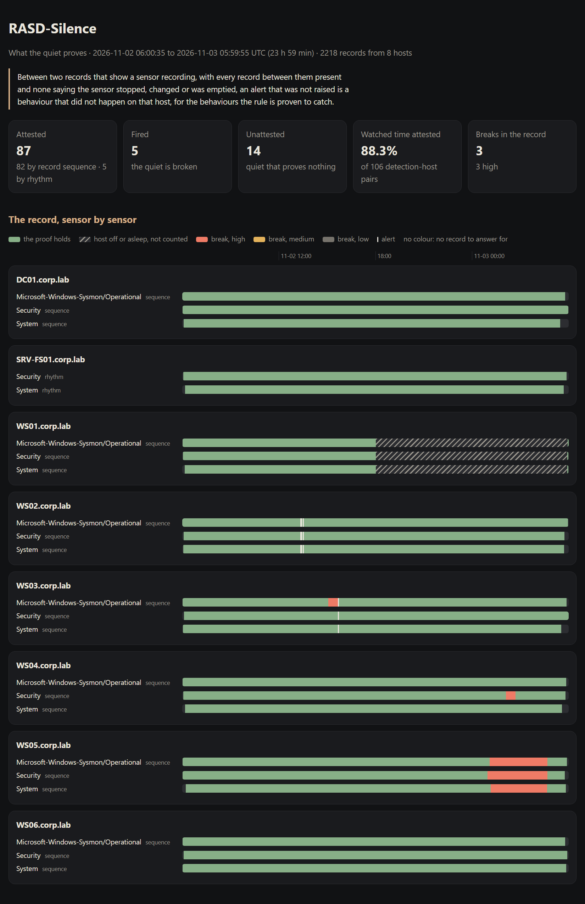

# RASD-Silence: Evidence of Absence

Every other proof in RASD answers for an alert: does the rule fire, on every variant, in every backend, and does its evidence survive. RASD-Silence answers for the alert that was not raised. A rule that stayed quiet for a month is read, everywhere, as "nothing happened". It says that only if the sensor it reads was recording the whole time, no record is missing, and nothing emptied or stopped the log in between. Otherwise the quiet is a blind spot that looks exactly like safety.

```bash
rasd silence my-export.jsonl --assets assets.csv        # every detection on every host: fired, attested or unattested
rasd silence my-export.jsonl --certificate silence.md   # the certificate: every verdict with what it rests on, and the limits
rasd silence my-export.jsonl --html silence.html        # the same as one page, with the map of every sensor over the window
rasd silence                                            # on Windows: this host's own event logs, read only
rasd silence --check                                    # the model against RASD-Trace, the rules and the engine (in CI)
```

The results for the sample fleet of this build are in [dfir/silence](../dfir/silence/README.md).



## The claim

One sentence, written in [`dfir/silence/model.yml`](../dfir/silence/model.yml) and printed on every certificate:

> Between two records that show a sensor recording, with every record between them present and none saying the sensor stopped, changed or was emptied, an alert that was not raised is a behaviour that did not happen on that host, for the behaviours the rule is proven to catch.

Each part of it is checked against the export, and the part that cannot be checked is named:

| Part of the claim | How it is established |
|---|---|
| the rule is proven to catch the behaviour | `rasd certify`: the behaviour spec beside the rule, each variant proven on every event or listed as a gap. The certificate prints both counts beside the detection |
| the sensor was recording | a record that only a recording sensor writes, before and after (below) |
| every record between them is present | the record number Windows gives every event of a channel: consecutive numbers leave no room for a missing record |
| none says the sensor stopped, changed or was emptied | the cut records of the model: a log cleared, a logging service stopped or started, a policy or configuration changed |
| the alert was not raised | every rule and correlation replayed over the same records, by the same engine as `rasd replay` |

## What proves a sensor was recording

The model names, for each artifact of [RASD-Trace](TRACE.md) a rule reads, what a record must be to count as proof:

| Proof | Meaning | Artifacts |
|---|---|---|
| `channel` | The record is written whenever the behaviour happens, whatever the configuration says. Any record of the channel shows its writer was up | System 7045 and 104, Security 1102 |
| `event` | The record is written only while a setting asks for it: a Sysmon configuration, an audit subcategory, a SACL. Only a record of the same kind shows the setting was on | Sysmon 1, 10 and 13, Security 4769, the authentication events, 4663, the decoy host's records |

A record of the kind the rule reads, anywhere in a run, proves the setting for the whole run: a change of setting would have left its own record, and that record is a cut. A rule that reads several event ids needs one record of each, because each is audited by its own setting: a domain controller that shows only logons does not show that failures or Kerberos requests are audited. A detection whose log source RASD-Trace does not model yet (Linux, web) is judged on its own records alone, as an `event` proof.

The sensor is the channel the model says the rule's record is written to. Another channel that carries records of the same log source (Security 4688 beside Sysmon 1) is not a second witness, and a record the rule cannot read (a field missing, as `rasd doctor` reports it) attests nothing whatever proves the sensor.

For a rule whose record is written on the host where the technique runs, every Windows host of the export gets a verdict. For a rule whose record an observer writes (a domain controller, a file server, the decoy host), the observers get one: the hosts that carry the most of the event ids the rule reads, so a workstation's own logons do not make it a domain controller. A host on which the rule fired always gets its verdict.

## Where the proof holds

The records of one channel of one host are put in the order they were written and cut into **runs**. A run ends where one of these lies between two consecutive records:

| Break | What the records show | Grade it needs |
|---|---|---|
| missing | record numbers skip, and no record says why | sequence |
| cleared | a clear record (Security 1102, System 104 naming the channel) with numbers missing across it. With whole numbers across it, nothing was lost and the run goes on | sequence; without numbers a clear always breaks |
| stopped | a record that the logging service or the sensor stopped or started, or a shutdown or sleep record followed by a pause | any |
| restarted | the record order and the clock disagree: the clock runs backwards and stays there, or one record number is carried by two different records. The log was replaced or recreated, or the clock was set back | any |
| quiet | no record for longer than the channel's own gaps allow | rhythm only |

A stretch bracketed by a shutdown and the next start, or by a sleep and the next wake, with no record from the host or naming it in between, is **time off**: it counts neither for nor against a detection. The records must be the stretch's own: a shutdown that a start already answered, or a start that answers a later shutdown, explains nothing. A stretch before a host's first record is never time off, since no shutdown record can show it. The two records sit at the ends of the stretch or a little inside it, because the Event Log service stops before the kernel does and starts after it: the model gives a shutdown two minutes at each end (`lag`), and a sleep, which does not stop that service, the twenty seconds any pair gets. Never past the other end of the stretch, and never across a record of the stretch that says otherwise: a log service that started again before the shutdown record did not stop for the shutdown. A stop without those records, or contradicted by another host that recorded the machine more than two minutes inside the stretch, stays a break.

For an `event` proof, a change record (Sysmon 16, Security 4719) splits a run: each side needs its own record of the kind the rule reads.

### The two grades

**Sequence.** When the export carries the record number (`EventRecordID`, `RecordNumber`, `winlog.record_id`) and its steps are consecutive (nine in ten, or more than half in a stream of fewer than thirty records), the order is the numbers' and a skipped number is a missing record. A skip or two in a short stream is therefore a hole, not an export that skips by design. With whole numbers a long quiet is not a break: nothing was taken out, and no record says the sensor stopped. Looking for gaps in record numbers is established practice among investigators; here it is one part of the claim, beside the proof that the sensor was recording, the proof of what the rule catches and the records that end either.

**Rhythm.** When the export carries no numbers, or ships only some event ids so that the numbers skip by design, nothing shows whether a record is missing. The channel is then held to its own rhythm: a gap longer than three times the gap it exceeds once in a hundred (and at least 15 minutes) is a break. A gap that is itself quiet against the others is left out of that count, so one long quiet does not hide itself. A channel with fewer than thirty gaps has no rhythm of its own and is held to the 15 minutes. This is weaker, and every verdict that rests on it says `rhythm`.

The same bound decides the two ends of the window: a channel whose first record comes later, or whose last record comes earlier, than its rhythm allows is not attested for that stretch. `--quiet MINUTES` sets the bound by hand.

## The verdicts

| Verdict | Meaning |
|---|---|
| fired | The rule raised an alert on this host in the window. The quiet is broken; `rasd replay` has the storyline |
| attested | Quiet, and the quiet is evidence, for the share of the watched time printed with it and with the grade it rests on |
| unattested | Quiet, and the quiet proves nothing here. The reason is one of: no record of the channel from this host; the channel is there and no record of the kind the rule reads is in it; the events lack a field the rule reads (`rasd doctor` says which); no host in the export writes what the rule reads. Each comes with what to turn on |

The watched time of a detection on a host runs from the first to the last record of its sensor inside the window, less the time off. The share attested is what the runs cover of it.

## Breaks in the record

Every stretch a sensor's proof does not cover is listed once, the gravest first. A stop that silences every channel of a host is one break, told by the channel whose records say the most about it.

| Severity | When |
|---|---|
| high | records missing; a channel cleared with records gone; the clock set back; a stop or a quiet during which the host was seen up: another of its channels kept its own rhythm, or another host recorded events naming it |
| medium | a logging service that stopped, or started with no record of a stop before it, and nothing else speaks of the host meanwhile; a quiet nobody contradicts |
| low | a record missing at the head of the export (see below); a channel whose first record comes late in the window |

"Another host recorded it" is read from the records themselves: a logon that names the workstation, or a client address that `--assets` resolves to the host. Two channels of one host that went quiet together do not vouch for each other.

## What Windows really writes

Four behaviours of Windows would turn an honest log into a false alarm if the tool trusted each record's own clock. They were measured on a Windows 11 host and each is covered by a test.

- **The record of a wake carries the clock of the moment the host fell asleep.** Kernel-Power 107 is stamped seconds after the Kernel-Power 42 that announced the sleep, hours before it was written. With record numbers the order is the numbers', and a record takes the latest time written before it. The wake itself is read from the Power-Troubleshooter record, which is written seconds after it with the new clock.
- **Boot records are not written in the order of their clocks.** The Event Log service writes its own start records (6009, 6005) before the kernel's earlier ones, and a stop (6006) is followed by more records before the host halts. A stop and the start that answers it are therefore one outage, placed at the widest wait between the two records, when the rest of the way from one to the other is short. A stop with no start after it is tied to the pause close after it, and a start with no stop to the pause before it.
- **A time filter leaves the stale record out.** An export cut by time does not contain a wake record stamped before the window, so one number is missing among the first records. It is reported as low, with that reason. Reading this host's own log avoids it: the first record of the window is found by time, and the log is read from its number on.
- **A restart can take less than half a minute, and the log is down longer than the host.** On the host measured, 27 s passed between the last record before a restart and the first after it, with nine records after the stop. The kernel's own records of that restart (Kernel-General 13 and 12) are stamped 5 s and 14 s inside those 27 s and were written after the Event Log's start records. A pause is therefore not looked for by its length where a stop and a start bracket it, and the seconds between the two services are part of the shutdown, up to the model's `lag`.

A clock that stays behind for three records in a row is a different thing: it was set back, and that is a break. One record stamped ahead of everything written after it carries a wrong clock, and does not stretch the window.

Two more follow from the same rule, that a record sits where it was written:

- **An alert sits where its record was written.** A rule that fires on a record stamped a day early has fired in this window.
- **A host that leaves its domain out of some records is one host**, when exactly one full name in the export fits the short one.

## What an export calls its fields

The channel and the event id are read under the names exports give them: `Channel` or `channel`; `EventID`, `EventCode`, `event_id` or `code`; 1100, "1100" and 1100.0 are one id. An export that dropped the channel is read by the log source its records route to. A clear record that does not name the channel it emptied (System 104 without `Channel_Cleared`) is taken to speak of every channel of the host but Security, which has its own record. Other fields are read by their native names; a telemetry profile (`--profile`) gives them to an export that names them differently.

## This host

On Windows, `rasd silence` with no export reads the host's own Sysmon, Security and System channels with `wevtutil`, for the last `--days` (7 by default). It only reads; nothing on the host is changed and nothing leaves it. It waits for Enter before it starts (`--yes` skips the wait), prints the answer, and writes the certificate beside it as `rasd-silence-<host>-<time>.md`, with the page as `.html`.

A channel that cannot be read is said so: the Security and Sysmon channels need an elevated prompt, and a host without Sysmon has no Sysmon channel. The detections that read them are then unattested. Each says which of the two it is: a channel that is there and closed asks for an elevated prompt, and a channel the host does not have asks for the sensor to be turned on.

A log read from the host is the log an administrator on that host could have altered. The record numbers still show a record removed or a log cleared; they do not show a log rewritten with its numbers made whole again. A copy forwarded as it was written does not have that limit, which is why the same command reads a SIEM export.

## The certificate

`--certificate FILE` writes what a compromise assessment hands over, with nothing in it that cannot be recomputed:

- the claim and the position of the intruder it assumes (the one of RASD-Trace)
- every input with its record count and SHA-256, and the command that was run
- the alerts, if the quiet is broken
- every attested detection and host, with its share of the watched time, its grade, its sensor, and what the quiet covers: the variants proven on every event and the documented ones that slip past
- every unattested one, with the reason and what would make it evidence
- every break in the record, and the time off that was not counted
- the documented variants a quiet rule does not cover, by detection
- every sensor: its records, its record numbers, its grade
- what the certificate does not say

`--html FILE` writes the same answer as one page. Its first part is a map: one bar per channel of each host across the window, coloured where the proof holds, hatched where the host was off, and marked where the record breaks and where a rule fired. `--json FILE` writes the result as JSON. The same inputs and the same build give the same verdicts.

## How it stands with the rest

| Tool | What it answers | What RASD-Silence adds |
|---|---|---|
| `rasd doctor` | Is a sample of this telemetry READY, DEGRADED or BLIND for each rule | The same question per host and over time, and whether what was recorded is whole |
| `rasd replay` | What fired; a rule with no alert is listed as `silent` | Whether that silence is evidence |
| `rasd certify` | Which behaviours a rule catches on every event | The scope of an attested verdict is exactly that, with the known gaps beside it |
| `rasd trace` | Which anti-forensic actions remove the evidence, and whether a rule sees them | Each cut names the actions of the trace model that leave it. The trace no Sigma rule can read, a host whose channels go quiet, is read here from the records |

## Limits

- **The behaviours.** A verdict holds for the behaviours the rule is proven to catch. A documented variant the rule misses, and a tool nobody has documented, can pass a quiet rule.
- **The catalogue.** The anti-forensic actions considered are those of `dfir/trace/model.yml`. Filtering events inside the logging service's memory and kernel tampering leave none of the records the model reads.
- **The numbers.** Record numbers show that no record is missing between two others. They do not show that a log rewritten with its numbers made whole again is the log the host wrote.
- **The settings.** A sensor's settings are read from what it wrote. A Sysmon configuration that excludes one program, or a SACL missing from one object, is not visible in the records of the others.
- **Time off.** A host that recorded a shutdown or a sleep and then the next start or wake, with no record from it or about it in between, is taken as off, with up to two minutes at each end of a shutdown in which the log service was down and the kernel was not. A forged shutdown record would hide a stretch that way; forging records is not among the catalogued actions, and another host that kept recording the machine overrides it.
- **Documented behaviour, not lab evidence.** Each entry of the model carries its basis: `vendor` for behaviour the vendor documents, `practitioner` for behaviour the DFIR community reports or that was observed on one host. No result here raises a detection's maturity.
- **Windows event logs.** The record number is a Windows event log property. Linux and web records are judged by rhythm, and RASD-Trace does not model their stores yet.

## How it was checked

Beside the unit tests, the tool was run on the event log of a Windows 11 host, on random exports that check its arithmetic (no share above the whole, no stretch outside the window), and against an independent review that built exports to make it say more than the records show. Each case the review reproduced is a test in `tests/test_silence.py` (`Soundness`): an alert on a record with an old clock, a shutdown already answered, a stream too short to have a rhythm, a start record of another channel, one event id standing in for five.

## Extending the model

1. A rule that reads a new artifact: add the artifact to `dfir/trace/model.yml` and the footprint, then its witness to `dfir/silence/model.yml` with `proof: channel` or `proof: event`, why, and what to enable.
2. A new record that ends a proof: add a cut with the values that recognise it (`record`), the channels it ends, its edge and a sample event. If a rule reads the record, name it in `detection`; `rasd silence --check` replays the event through the engine either way.
3. A new way a host is off: add a pair to `down`, with the record that opens it and the record that closes it. Use a closing record that is stamped after the wake, and give the pair a `lag` only when the log service is down longer than the host at its ends.
4. Run `rasd silence --check`, then `rasd build`.
