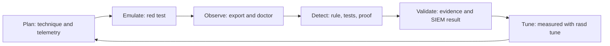

# RASD-Purple: Attack-to-Defense Validation

The bridge that connects everything: proof that offensive behaviour produces telemetry, that detection catches it, that DFIR can investigate it, that CTI gives it context - and that all of it is measured.

| File | Contents |
|---|---|
| [`scenarios/`](scenarios/) | One scenario per covered technique: Objective, Red, Telemetry, Detect, DFIR, Intel, Success Criteria |
| [`validation_matrix.md`](validation_matrix.md) | The matrix, the 20-point completeness map, maturity per detection, measured gaps (generated) |
| [`attack_to_detection_map.md`](attack_to_detection_map.md) | Technique → red test → telemetry → detections → queries → playbook (generated) |
| [`evidence_matrix.md`](evidence_matrix.md) | Operational evidence per detection (generated) |
| [`detection_latency.md`](detection_latency.md) | Measured telemetry and SIEM latency per detection (generated) |

## The loop

1. **Plan** - pick the technique by threat relevance (the [actor map](../intel/mappings/actor_tradecraft_map.md)), and check that the telemetry in the test's `expected_telemetry.md` is collected.
2. **Emulate** - run the red test on a lab VM; the runner records windows, artifacts and cleanup.
3. **Observe** - export the logs; `rasd doctor` says whether each rule can work on them (fields, aliases, truncation).
4. **Detect** - a miss becomes a new true positive, then a rule change proven by `test`, `prove`, `fuzz` and `parity`.
5. **Validate** - `rasd evidence` writes evidence only when the rule fired; the SIEM alert export adds the SIEM result and latency.
6. **Tune** - every production false positive becomes a true negative first; every filter is measured by `rasd tune` before it is applied.

## Metrics worth reporting
| Metric | Where |
|---|---|
| Validated technique coverage | [validation_matrix.md](validation_matrix.md) - techniques whose detections are Validated or Reference |
| Mean detection latency | [detection_latency.md](detection_latency.md) |
| Telemetry gap rate | MISSED detections in `rasd evidence`, and the gaps section of the matrix |
| Rule regression rate | Pull requests blocked by `rasd diff` (REGRESSION / NEW FALSE POSITIVE) |
